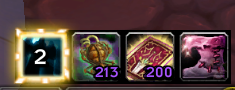

# TrinketBuddy



> World of Warcraft **3.3.5a (WotLK)** addon · made by **feralpaw** · version **1.1.2**

**Fast jump:** [Features](#features) | [Install](#install) | [Moving icons](#moving-icons) | [Glow](#glow) | [Group frame](#group-frame) | [Profiles](#profiles) | [Mouse controls](#mouse-controls) | [Commands](#commands) | [Options](#options) | [Changelog](#changelog)

- Tracks the procs and cooldowns of your equipped trinkets, rings and enchants — no WeakAuras to set up for every new character or item.
- Full database of WotLK and TBC trinkets (plus some Classic ones).
- Ashen Verdict rings, Signet of Edward the Odd, cloak, weapon, hands, boots and belt enchants and tinkers.
- Doesn't depend on the combat log.
- Shows proc duration, stacks and internal cooldown; on-use cooldowns as well.
- Tracks cooldowns on login and after you change gear.
- Remembers a trinket's cooldown even after you unequip it.
- Built-in cooldown text (or use OmniCC).
- Light on resources: one event handler and one shared timer for all icons; the timer only runs while something counts down.

---

## Features

### Icons
| Icon | What it tracks |
|---|---|
| **Trinket 1 / Trinket 2** | proc buff (with stacks), internal cooldown, on-use cooldown |
| **Hands** | Hyperspeed Accelerators and other glove tinkers |
| **Boots** | Nitro Boosts |
| **Belt** | Frag Belt |
| **Cloak** | Lightweave, Swordguard, Springy Arachnoweave / Flexweave |
| **Weapon** | Berserking, Mongoose, Black Magic, Executioner, Blood Draining, Crusader |
| **Ring** | Ashen Verdict rings (Revered / Exalted) and Signet of Edward the Odd |

- Proc active → the icon glows, shows the proc's spell icon and counts the buff down
- On cooldown → grey icon with countdown
- Item level in the item's quality colour (optional)
- Every icon can be turned on or off on its own

### Defaults
- All icons are **32 px**
- Only **Trinket 1, Trinket 2, Hands and Boots** are active, in one straight row
- On the very first start the icons are **unlocked**, so you can place them right away

---

## Install

1. Download the latest ZIP from **Releases** (or *Code → Download ZIP*).
2. Copy the `TrinketBuddy` folder into `World of Warcraft/Interface/AddOns/`.
   The folder name must stay exactly `TrinketBuddy`.
3. Restart the game completely (new addons are only found at game start).

Settings are saved per character (`TrinketBuddyChar`), profiles account-wide (`TrinketBuddyDB`).

---

## Moving icons

### How to use
1. Tick **Unlock icons** in Esc → Interface → AddOns → TrinketBuddy (or type `/tb unlock`)
2. All icons show up above the options window: green = active, dark = turned off, red = would overlap
3. **Left-click and drag** an icon to move it
4. Click the **checkmark** in an icon's corner to turn that icon on or off completely
5. Untick the box again (or `/tb lock`) when you're done

### Overlap protection
- While dragging, the icon turns red if it would overlap another active icon
- When you let go it lands on the nearest free spot; if there is none on screen it goes back
- Turned-off icons don't block space
- The X/Y sliders are not restricted — use them if you want icons to overlap on purpose

### Snapping
- Dropped within ~10 px of another icon's row or column, an icon lines up exactly (centres, top/bottom or left/right edges)
- Close to a neighbour it docks right next to it — beside, above or below
- Blue guide lines show the snap while you drag; hold **Shift** while dropping to place freely
- Can be turned off with **Snap icons into line**

### Notes
- Icons can't be moved in combat; entering combat locks them automatically
- Positions are saved instantly; the X/Y sliders follow your drags
- **Reset positions** puts all icons back to the default row

---

## Glow

### Proc glow
- Appears while a proc buff is active and disappears when it fades
- Three styles: **Soft glow** (pulsing), **Frame** (pulsing coloured frame), **Sparks** (sparks running around the icon)
- Free colour choice

### Ready glow
- On-use trinkets glow (green by default) while they are **ready to use**
- **Only in combat** (default) or always
- Own colour, separate from the proc glow

Glow can be turned off per icon on the Icons page.

---

## Group frame

An optional box behind all your icons — **off by default**.

- Follows the icons when you move them
- Padding, border thickness, border colour, background colour and opacity

Each icon also has its own thin border (**Border around each icon**, on by default; thickness per icon).

---

## Profiles

### What's in a profile
- Positions, sizes, zoom, borders and text sizes of every icon
- Which icons are turned on
- All general options (visibility, glow, font, group frame, …)

### In chat
```
/tb save MyLayout      — save the current setup
/tb load MyLayout      — load a profile
/tb delete MyLayout    — delete a profile
/tb profiles           — list all profiles
```

### In the options
1. `/tb` → **Profiles**
2. Pick a profile from the list or type a new name
3. **Save**, **Load** or **Delete**

### Same layout on another character
1. Set up your icons on character A
2. `/tb save main`
3. Log in on character B
4. `/tb load main`

---

## Mouse controls

Out of combat, hold the modifier and click an icon:

| Click | Action |
|---|---|
| **Ctrl + Left** | Take the item off and put it back on |
| **Shift + Left** | Switch the two trinket slots |
| **Alt + Left** | Equip another copy of the item (e.g. different item level) |
| **Ctrl + Right** | Swap to your swap trinket and back |

- The swap trinket is the **Gnomish Battle Chicken** by default — pick any trinket in the options
- After the swap trinket has been used, your previous trinket goes back on automatically
- Optional **Click an icon to use the item** (needs `/reload`)

---

## Commands

| Command | What it does |
|---|---|
| `/tb` or `/trinketbuddy` | Open the options |
| `/tb unlock` · `/tb lock` · `/tb move` | Move icons with the mouse |
| `/tb save <name>` | Save the current setup as a profile |
| `/tb load <name>` | Load a profile |
| `/tb delete <name>` | Delete a profile |
| `/tb profiles` | List all profiles |
| `/tb reset` | Back to defaults (reloads the UI, profiles are kept) |
| `/tb help` | Show all commands |

---

## Options

Esc → Interface → AddOns → **TrinketBuddy** (or `/tb`):

- **TrinketBuddy** — visibility, icon borders, moving & snapping, which icons are tracked, clicking & swap trinket
- **Icons** — pick an icon: shown, item level, glow, size, X/Y, zoom, border, text sizes; *Apply to all icons*
- **Look** — proc glow & ready glow (style, colours), font (Blizzard fonts + LibSharedMedia), group frame
- **Profiles** — save / load / delete, chat commands

---

## Changelog

### 1.1.2 (2026-10-25)
- New option **Border around each icon** (default on)

### 1.1.1 (2026-10-25)
- Options pages in one column, so nothing is cut off in the 3.3.5 options window

### 1.1.0 (2026-10-25)
- Ready glow for on-use trinkets (own colour, optional "only in combat")
- Per-icon **Glow** switch covers proc glow and ready glow

### 1.0.0 (2026-10-25)
- First release

---

## License

MIT – see [LICENSE](LICENSE).
